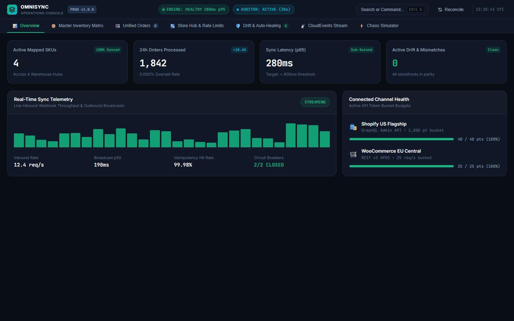

# OmniSync

> An in-memory inventory-sync engine for stores selling on both Shopify and WooCommerce: one master ledger takes HMAC-verified order webhooks, deducts stock under a per-SKU lock, and pushes the new level to every channel, so a sale on one store does not oversell the other.

**Status:** Prototype (Aug 2026) · in-memory ledger; the Shopify and WooCommerce adapters are mocks, so no real store is connected · 47 tests pass (`npm test`, verified on Node 24)
**Demo:** none yet (no video or live deployment)



*The dashboard is real, but parts of it are scripted: the throughput chart uses random values and the "chaos" console is an animation (`src/frontend/app.js`).*

## How it works

1. A signed webhook arrives at `/api/v1/webhooks/shopify/:storeId` or `/api/v1/webhooks/woocommerce/:storeId`. The HMAC-SHA256 signature is checked over the raw body with a timing-safe compare.
2. An idempotency guard (24-hour TTL) drops replayed event IDs. It only catches sequential replays; concurrent duplicates can both be processed on `main`.
3. The ledger (`src/backend/ledgerEngine.ts`) applies a signed stock delta under a per-SKU lock, in a single process, and appends to an audit log.
4. Updated levels go through an in-process event emitter to the **mock** channel adapters (`src/integrations/channelAdapter.ts`), which write to local maps. Nothing calls Shopify or WooCommerce.
5. A drift check compares channel stock to the ledger and corrects differences. It runs only when you call `POST /api/v1/reconciliation/trigger`.

Also included: four warehouse locations with transfers, bundle SKUs that deduct their components, a three-state circuit breaker, per-channel token-bucket limiters, and a server-sent-events stream of CloudEvents-shaped messages.

## Quickstart

Requires Node.js 22.18 or newer (the code runs `.ts` files directly through Node's type stripping; the repo was tested on Node 24.15). There are no runtime dependencies, so no install step is needed to run.

```bash
git clone https://github.com/HamzaKhanBUIC/omnisync-ecommerce-operations.git
cd omnisync-ecommerce-operations
npm test        # 47 tests in 13 files, about 33 s
npm start       # http://localhost:3000
```

`npm start` runs `node src/index.ts` and seeds a demo catalog of 5 SKUs and two demo stores.

`npm run build` (`tsc`) currently fails with type and config errors; it is not needed to run or test.

## Configuration

| Variable | Default | Description |
| :--- | :--- | :--- |
| `PORT` | `3000` | HTTP port |

No other environment variables are read on `main`. Webhook secrets and demo API keys are set in code (`src/index.ts`).

## API

| Method | Endpoint | Description |
| :--- | :--- | :--- |
| `GET` | `/health` | Uptime and store counts |
| `GET` | `/api/v1/inventory` | Ledger stock and channel mappings (optional `sku` filter; not paginated) |
| `POST` | `/api/v1/inventory/adjust` | Manual stock adjustment |
| `POST` | `/api/v1/inventory/transfer` | Transfer between warehouse locations |
| `GET` | `/api/v1/orders` | Order stream |
| `GET` | `/api/v1/audit` | Ledger audit trail |
| `POST` | `/api/v1/reconciliation/trigger` | Run the drift check |
| `GET` | `/api/v1/circuit-breakers` | Circuit breaker states |
| `GET` | `/api/v1/events/stream` | Server-sent events |
| `POST` | `/api/v1/webhooks/shopify/:storeId` | Shopify-style order webhook (`X-Shopify-Hmac-Sha256`) |
| `POST` | `/api/v1/webhooks/woocommerce/:storeId` | WooCommerce-style order webhook (`X-WC-Webhook-Signature`) |

## Limitations

- **All state is in memory.** There is no database, no persistence and no multi-process support. A restart resets everything. There is no PostgreSQL, Prisma, transactional outbox or version-based concurrency control.
- **Channels are mocked.** No request is sent to Shopify or WooCommerce. Latency and rate-limit behavior are properties of the mocks. No latency benchmark exists in the repo.
- **Not safe to expose on `main`.**
  - Unknown store IDs fall back to secrets hard-coded in the source.
  - The adjust, transfer and reconcile routes need no authentication, and CORS allows any origin.
  - Webhook quantities are not validated.
  - The dashboard renders order fields with `innerHTML`.
  - These are fixed in [open PR #1](https://github.com/HamzaKhanBUIC/omnisync-ecommerce-operations/pull/1) (except the dashboard escaping); do not deploy before it is merged.
- **Concurrent duplicate webhooks** are not blocked by the idempotency guard on `main` (also addressed in PR #1).
- **Dashboard** values for throughput and the chaos console are simulated.
- **Docs in `docs/` and `testing/` still describe PostgreSQL, Redis and production operations**, which do not match the code. Treat them as design notes.
- The Python scripts under `scripts/` only print hard-coded data; they do not call the server.

## License

MIT. See [LICENSE](LICENSE).
